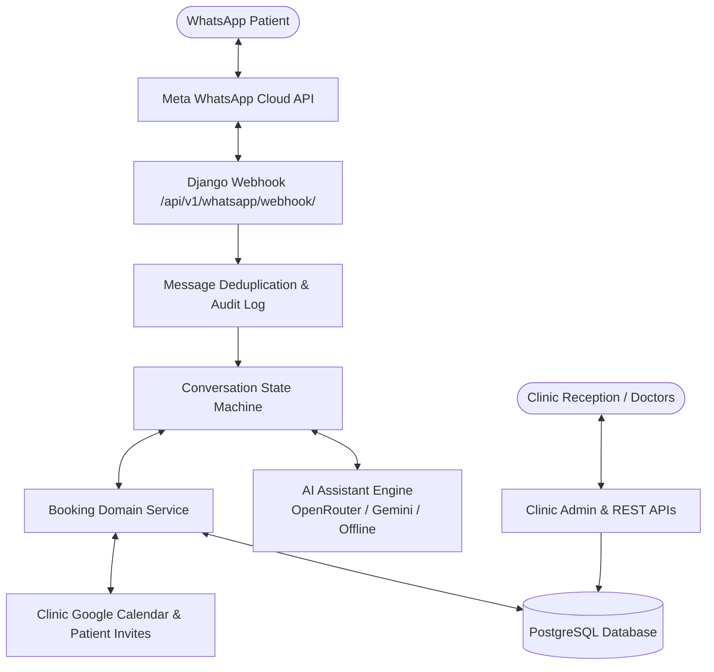
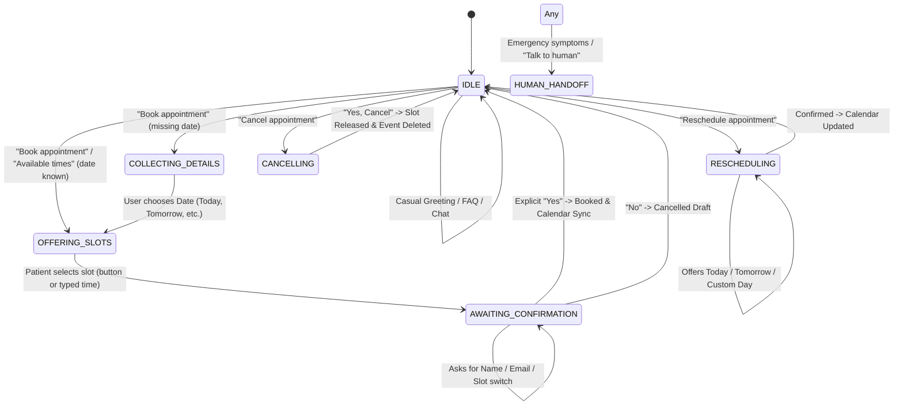

# Clinic OS Architecture Documentation

## 1. System Overview

**Clinic OS** is a dedicated, production-grade AI booking and operational management platform architected specifically for a **single client / private dental clinic**. Rather than a multi-tenant SaaS system with generic abstractions, Clinic OS is optimized for deep customization, uncompromising data privacy, direct Google Workspace integration, and dedicated WhatsApp Business API throughput.



---

## 2. Dedicated Single-Client Architecture Principles

1. **Dedicated Infrastructure**:
   - The database, Google Calendar, and WhatsApp Business API credentials belong directly to the client's clinic.
   - Eliminates cross-tenant data leak risks, row-level tenant filtering overhead, and shared rate limits.

2. **Calendar as the Scheduling Source of Truth**:
   - Appointment availability is dynamically calculated by intersecting clinic operating hours (Monday–Saturday 9:00 AM – 7:00 PM), existing database bookings, and live Google Calendar busy intervals in the `Asia/Kolkata` timezone.
   - The AI assistant is never allowed to hallucinate or invent slots; every offered time exists on the live calendar.

3. **Concurrency & Double-Booking Prevention**:
   - Slots are protected via atomic `BookingReservation` database locks with a 10-minute TTL.
   - When a slot is chosen, an atomic database transaction prevents concurrent claims:
     ```sql
     SELECT id FROM appointments_appointment
     WHERE starts_at < :end_at AND ends_at > :start_at
       AND status NOT IN ('cancelled', 'no_show');
     ```
   - Two-phase commit with compensation: If the Google Calendar API call fails, the database lock is released immediately.

4. **Bi-directional Google Calendar Synchronization**:
   - When an appointment is confirmed, the patient's email is added as a calendar attendee with `sendUpdates="all"`, sending a personal Google Calendar invitation.
   - Rescheduling and cancellations update or release the Google Calendar event in real time.
   - A Django `post_delete` signal ensures that deleting an appointment in the database automatically cleans the event from Google Calendar.
   - A dedicated `py manage.py sync_calendar` command provides automated reconciliation.

5. **Conversational AI Chatbot with WhatsApp Buttons**:
   - Handles natural human conversation (casual greetings, typos like `6;30`, date changes, polite thank-yous).
   - Groups all available times clearly into 🌅 Morning, ☀️ Afternoon, and 🌆 Evening.
   - Generates interactive WhatsApp buttons (within Meta's 3-button limit) while allowing patients to tap or type any available time.

---

## 3. Domain Boundaries

| App / Module | Responsibilities |
|---|---|
| `apps.clinics` | Dedicated clinic profile, operating hours, slot duration, and timezone settings. |
| `apps.patients` | Patient directory, WhatsApp identifiers, phone numbers, and communication consent. |
| `apps.appointments` | Confirmed appointments, atomic `BookingReservation` locks, and lifecycle signals. |
| `apps.conversations` | Patient journey state machine, multi-turn context memory, and inbound/outbound message auditing. |
| `apps.integrations.whatsapp` | Meta Cloud API webhook signature verification (SHA256 HMAC), payload parsing, and interactive button messaging. |
| `apps.integrations.google_calendar` | OAuth 2.0 integration, FreeBusy interval queries, calendar event creation, attendee invites, and synchronization. |
| `apps.ai_assistant` | Dual-engine natural language understanding (OpenRouter + Gemini + offline deterministic fallback). |
| `services.booking_service` | Orchestrates atomic reservations, database transactions, calendar synchronization, and compensation. |

---

## 4. Conversation State Machine Flow



---

## 5. Security & Privacy Safeguards

- **Webhook Signature Security**: Every inbound Meta webhook payload is verified using SHA256 HMAC against `WHATSAPP_APP_SECRET`.
- **Secret Isolation**: Secrets (`.env`, OAuth tokens, database URLs) are strictly excluded from git via `.gitignore` and `.dockerignore`.
- **Medical Guardrails**: The AI assistant contains explicit clinical safety prompts that reject providing diagnoses or prescription advice, immediately escalating emergencies to human clinic staff.
