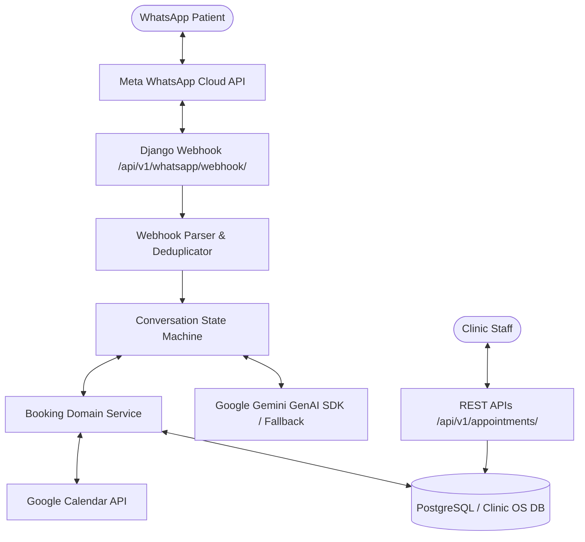
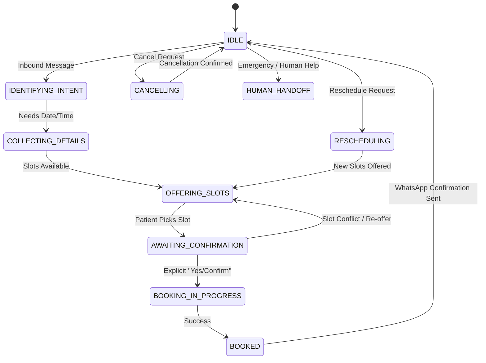

# Clinic OS — AI-Powered WhatsApp Booking Backend

Clinic OS is a production-grade backend for dental clinic management and conversational appointment booking in India. It bridges **Meta WhatsApp Cloud API**, **Google Gemini AI**, and **Google Calendar** with an explicit state machine, multi-tenant isolation, atomic slot reservations, and compensation mechanics.

---

## Architecture Overview



### Core Design Principles
1. **AI as an Interpreter, Not Authority**: Google Gemini interprets natural language intent, extracts parameters, and formulates suggested replies. It is **never** permitted to invent slots, modify databases, or finalize bookings.
2. **Calendar-Truth Scheduling**: All available slots are strictly calculated using clinic operating hours, existing DB appointments/reservations, buffer times, minimum notice, and Google Calendar FreeBusy intervals in the `Asia/Kolkata` timezone.
3. **Double-Booking Prevention**: Slots are protected via atomic `BookingReservation` records, database transactions, and calendar API reconciliation. If an external calendar call fails, compensation logic rolls back the reservation and prevents ghost events.
4. **Clinic Multi-Tenant Isolation**: Clinic staff belong to specific clinics via `ClinicMembership`. Access controls ensure clinic users cannot access patient data or appointments belonging to other clinics.
5. **Idempotency**: Webhook deliveries are deduplicated using Meta's `external_message_id`, preventing duplicate replies or appointments.

---

## Tech Stack
- **Python**: 3.10+
- **Django**: 5.2+
- **Django REST Framework**: 3.18+
- **PostgreSQL / SQLite**: psycopg 3 (PostgreSQL in production, SQLite fallback for local test/dev)
- **Meta WhatsApp Cloud API**: Graph API v21.0
- **Google Gemini API**: Official `google-genai` Python SDK
- **Google Calendar API**: `google-api-python-client` with OAuth 2.0
- **Testing**: `pytest`, `pytest-django`

---

## Directory Structure
```
backend/
├── apps/
│   ├── accounts/              # User and staff authentication
│   ├── clinics/               # Clinic configuration, hours & memberships
│   ├── patients/              # Patient records, WhatsApp identifiers & consent
│   ├── appointments/          # Appointments, BookingReservation model & REST views
│   ├── conversations/         # State machine, conversation context & message logs
│   ├── integrations/
│   │   ├── whatsapp/          # Webhook verification, signature security & Graph API client
│   │   └── google_calendar/   # Google OAuth, FreeBusy calculation & event management
│   ├── ai_assistant/          # Gemini adapter, structured schemas & mock fallback
│   ├── consultations/         # Clinical consultations (pre-existing starter app)
│   └── audit/                 # Security audit event logging
├── services/
│   └── booking_service.py     # Domain service for reservations, calendar sync & transactions
├── tests/                     # 33 comprehensive automated tests
├── config/                    # Django settings, root URLs, WSGI/ASGI
├── .env.example
├── manage.py
├── pytest.ini
└── requirements.txt
```

---

## Getting Started Locally

### 1. Clone & Set Up Virtual Environment
```bash
git clone <repo-url>
cd clinic-os-starter/backend

python -m venv venv
# Windows:
venv\Scripts\activate
# Linux/macOS:
source venv/bin/activate

pip install -r requirements.txt
```

### 2. Configure Environment Variables
Copy `.env.example` to `.env`:
```bash
cp .env.example .env
```

Key environment settings:
- For rapid local development without a running PostgreSQL server, set:
  ```env
  USE_SQLITE=True
  ```
- To connect to local PostgreSQL:
  ```env
  USE_SQLITE=False
  DATABASE_ENGINE=django.db.backends.postgresql
  DATABASE_NAME=clinic_os
  DATABASE_USER=clinic_os
  DATABASE_PASSWORD=your_password
  DATABASE_HOST=127.0.0.1
  DATABASE_PORT=5432
  ```

### 3. Run Migrations & System Check
```bash
python manage.py makemigrations
python manage.py migrate
python manage.py check
```

### 4. Run Automated Tests
```bash
pytest
```
*All 33 automated tests run 100% offline using simulated mock adapters without requiring live paid credentials.*

### 5. Start Development Server
```bash
python manage.py runserver 0.0.0.0:8000
```

---

## Meta WhatsApp Cloud API Setup

1. **Create Meta Developer App**:
   - Go to [developers.facebook.com](https://developers.facebook.com/) and create a **Business** App.
   - Add the **WhatsApp** product.
2. **Retrieve API Credentials**:
   - Obtain your **Phone Number ID** and **Temporary/Permanent Access Token**.
   - Copy your **App Secret** from App Settings > Basic.
3. **Configure Webhook**:
   - In your WhatsApp App Dashboard > Configuration > Webhook:
     - Callback URL: `https://<your-public-domain>/api/v1/whatsapp/webhook/` (use ngrok for local development).
     - Verify Token: Matches `WHATSAPP_VERIFY_TOKEN` in your `.env`.
   - Subscribe to the **`messages`** webhook field.
4. **Set `.env` variables**:
   ```env
   WHATSAPP_ACCESS_TOKEN=your_token
   WHATSAPP_PHONE_NUMBER_ID=your_phone_id
   WHATSAPP_VERIFY_TOKEN=clinic_os_verify_token_secure
   WHATSAPP_APP_SECRET=your_app_secret
   WHATSAPP_API_VERSION=v21.0
   ```

---

## Google Gemini API Setup

1. Go to [Google AI Studio](https://aistudio.google.com/) and generate an API key.
2. In `.env`:
   ```env
   GEMINI_API_KEY=AIzaSy...
   GEMINI_MODEL=gemini-2.5-flash
   ```
3. *Note*: If `GEMINI_API_KEY` is empty or starts with `mock_`, the system automatically activates the offline `MockAIAssistant`, enabling development and tests without API fees or internet access.

---

## Google Calendar API Setup

1. In the [Google Cloud Console](https://console.cloud.google.com/):
   - Enable the **Google Calendar API**.
   - Create an **OAuth 2.0 Client ID** (Web application).
   - Add Authorized Redirect URI:
     `https://<your-domain>/api/v1/integrations/google-calendar/callback/`
2. Update `.env`:
   ```env
   GOOGLE_CLIENT_ID=xxx.apps.googleusercontent.com
   GOOGLE_CLIENT_SECRET=your_client_secret
   GOOGLE_CALENDAR_ID=primary
   CLINIC_TIMEZONE=Asia/Kolkata
   ```
3. Connect Calendar for a Clinic:
   - Make an authenticated GET request to `/api/v1/integrations/google-calendar/connect/?clinic_id=<uuid>`.
   - Open the returned `authorization_url` to approve access.
   - The callback securely exchanges the code and stores the refresh token in `GoogleCalendarConfig`.

---

## Conversation State Machine



---

## API Endpoints Reference

| Endpoint | Method | Auth | Description |
|---|---|---|---|
| `/api/v1/health/` | GET | Public | Health check |
| `/api/v1/whatsapp/webhook/` | GET | Public | Meta webhook verification handshake |
| `/api/v1/whatsapp/webhook/` | POST | Public (HMAC Verified) | Incoming messages & status processing |
| `/api/v1/integrations/google-calendar/connect/` | GET | Staff Auth | Generate Google OAuth consent URL |
| `/api/v1/integrations/google-calendar/callback/` | GET | Public | Google OAuth callback handler |
| `/api/v1/appointments/` | GET | Staff Auth | List clinic appointments (tenant isolated) |
| `/api/v1/appointments/` | POST | Staff Auth | Create appointment via domain service |
| `/api/v1/appointments/availability/` | GET | Public | Get real available slots for clinic & date |
| `/api/v1/appointments/<id>/reschedule/` | POST | Staff Auth | Reschedule existing appointment |
| `/api/v1/appointments/<id>/cancel/` | POST | Staff Auth | Cancel appointment & sync external calendar |

---

## Security, Privacy & Indian DPDP Act Compliance

1. **Digital Personal Data Protection Act (DPDP), 2023 Guidelines**:
   - **Data Minimization**: Only contact identifier and voluntary patient names are captured during booking. Full AI prompts and clinical dialogues are not logged.
   - **Consent Mechanism**: Patient WhatsApp interaction explicitly implies and records consent for appointment notifications (`consent_status=True`).
   - **Purpose Limitation**: Patient phone numbers are used solely for appointment scheduling, rescheduling, and confirmations.
   - **Right to Erasure & Access**: Staff APIs provide access to appointment records; patient cancellation fully removes pending reservations.
2. **HMAC-SHA256 Signature Verification**: All webhook requests from Meta are validated against `X-Hub-Signature-256` using the clinic's `WHATSAPP_APP_SECRET`.
3. **Medical Emergency Safeguards**: Clinical diagnosis or triage is strictly prohibited. High-acuity symptoms immediately trigger human escalation and direct patients to emergency care.
